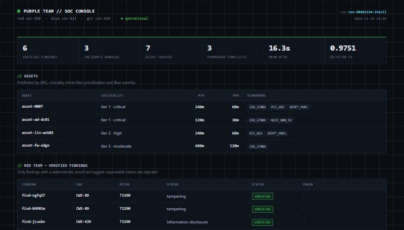

# Technical Project Reports

One technical report per course, written from the real built system (8–10 pages
each after PDF export). Only the cover-page identity fields (`<Name — ID>`, team
number) need completing.

| Course | Report | System |
|---|---|---|
| CNC 418 — Software Security | [`CNC418_Report.md`](CNC418_Report.md) | Red Team agent |
| CNC 411 — Fundamentals of Cybersecurity | [`CNC411_Report.md`](CNC411_Report.md) | Blue Team pipeline |
| CNC 419 — IT Security & Risk Management | [`CNC419_Report.md`](CNC419_Report.md) | GRC platform |

Each report follows the handout's required contents: overview + system
architecture (incl. the cross-course Red–Blue–GRC workflow), tools/models/
frameworks, comprehensive answers to the architectural questions, verification &
telemetry artifacts, deployment & user guide, division of work, and an AI-use
disclosure + references.

## Figure — the SOC console dashboard



*One correlated Purple Team exercise across all three systems. Generate with
`python integration/dashboard/build_dashboard.py` → `integration/dashboard/dashboard.html`.*

## Export to PDF (for submission)

The reports are Markdown so they version cleanly. Export each to PDF with
whatever you already have — e.g. open in VS Code with a Markdown-PDF extension,
paste into Google Docs / Word and export, or any Markdown previewer's "print to
PDF". Name the files as the assignment requires:

```
TeamXX_CNC418_Report.pdf
TeamXX_CNC411_Report.pdf
TeamXX_CNC419_Report.pdf
```

Before submitting, confirm each report is 8–10 pages, figures are legible, and the
cover-page identity fields are filled in.
